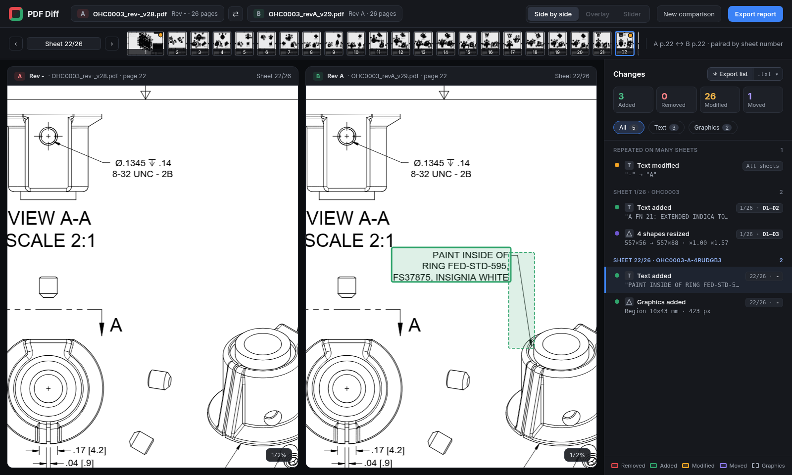

# PDF Diff

A web app that compares two revisions of the same PDF and highlights what changed, in both **text** and **vector graphics** (technical drawings, plans, schematics). Changes are shown side by side, as an overlay, or with a slider. They are listed with sheet number and drawing grid reference (e.g. `Sheet 1/26  D1–D3  Added  ...`) and can be exported as a plain-text report.

**Status:** first browser increment in [`app/`](app/) (side-by-side viewer, text diff, vector + raster graphics diff, border-grid references, change list, plain-text export). The Python prototype in `prototype/` is the reference for sampled-geometry matching, which is still to come.

- [`PLAN.md`](PLAN.md): technical plan (architecture, text/vector diffing, grid detection, report format, milestones, prototype findings)
- [`docs/mockups/`](docs/mockups/): UI mockups (`mockup.png`, `export-preview.png`), built from `gen.py`, which writes the HTML; screenshot it with headless Chrome
- [`app/`](app/): the web app (Vite + React + TypeScript + PDF.js); runs entirely in the browser
- [`prototype/`](prototype/): Python proof of concept for the diff engine


## Running the web app

Requires Node.js 20+.

```bash
cd app
npm install
npm run dev                 # http://localhost:5173, then drop Rev A (old) and Rev B (new)
npm run build               # type-check + production build into app/dist/
npm test                    # unit tests (vitest): diff, pairing, folding, report, raster
```

End-to-end tests and screenshots use Playwright. They need the OpenHornet samples (`prototype/fetch_samples.sh`, see below) and a Chromium. An installed Chrome at `/usr/bin/google-chrome` or `$CHROME_PATH` is used; otherwise run `npx playwright install chromium` once.

```bash
(cd prototype && ./fetch_samples.sh)
cd app
npm run test:e2e            # OpenHornet OHC0003 and OH2A2A1-1 rev - -> rev A expectations + self-vs-self = 0 changes; also writes the screenshots
npm run screenshots         # only regenerate docs/screenshots/*.png
npm run fixtures            # regenerate the synthetic PDF pairs in app/e2e/fixtures/ (moved text, resized/moved/recoloured boxes)
```

The synthetic fixtures (our own, committed) run without the OpenHornet samples; see [`app/e2e/fixtures/README.md`](app/e2e/fixtures/README.md).

What the app does today:

- **Pairing** by title-block sheet number (`n/m` next to `SHEET`, or `n OF m`), else by page order. Pages without a partner are listed as inserted or deleted.
- **Text diff:** PDF.js positioned words. A word with the same text at the same place on both pages (±1 pt after page alignment) is unchanged. The remaining words get a word-level Myers diff in reading order (in a Web Worker). Words that match there but sit elsewhere become **Moved** (grouped by common displacement), and so do removed + added blocks with identical text. A match is rejected as a move when its old line neighbours were deleted or its new ones inserted (identical text in a new context, e.g. a part name quoted in a new revision note, is new text, not a move). Removed + added text on the same line, close together, becomes *modified*, also across Myers runs, with a character-level refinement. Edit runs are split spatially, and cells of one table row are merged. A page offset is estimated from words that are unique on both pages.
- **Vector layer:** painted paths are read from each page's PDF.js operator list (`constructPath` with CTM, form XObject matrices and fill/stroke colour and width). `re` boxes and m/l/h boxes are both recognised as boxes. Identical shapes cancel. Remaining removed + added shapes are paired:
  - same geometry in another style → **Modified** (e.g. `fill #000000 -> #e61a1a`)
  - same style, size and outline (normalised point signature) elsewhere → **Moved** (dx, dy). A move needs either a displacement shared by 3+ neighbouring shapes or a single unambiguous copy (not for plain lines). Small moves/resizes next to unpaired added/removed geometry are released (a redrawn area pairs identical primitives by coincidence) and report as graphics regions instead. Candidate generation is bucketed by size and position, so sheets with thousands of changed paths still pair.
  - same style and type with another size, overlapping or nearby → **Resized** (old and new size, scale factors); shapes resized together, such as a table outline and its column lines, are grouped
  Each vector change must be confirmed by differing pixels outside the part the old and new shape share. This keeps re-exported, re-tessellated paths that render the same from being reported.
- **Graphics diff (raster fallback):** each pair is rendered at 150 DPI (long side capped at 4200 px). B is shifted by the offset candidate that leaves the fewest differing pixels. A tolerant 3×3 pixel comparison runs in a Web Worker. **All** text boxes (old and new) and confirmed vector changes are masked out, and the rest is clustered into regions. These cover added/removed shapes, images and shadings. Overlapping removed + added regions are paired as *modified*. Inside a large coherent move (a whole view shifted, 20+ shapes) the area is compared again with B shifted back by the move; only pixels that differ under both alignments, in clusters of real size that were clearly added or removed, are reported (e.g. a part that is new inside a regenerated view).
- Displacements are in points with the page's top-left origin: **+dx = right, +dy = down**.
- **Folding:** a change repeated identically on ≥ half of the paired sheets (e.g. the title-block REV letter) is listed once.
- **UI:** synced zoom (wheel, around the cursor) and pan (drag) in both panes. Click a change to jump and zoom to it. Filters are All / Text / Graphics. Moved and resized items are violet; on Rev B a dashed ghost and an arrow show the old position. Export shows a preview, **Copy** and **Download .txt** (PLAN.md §6 format).
- **Grid references:** border zone labels are found in a band along the frame (5 % of the shorter side, at least 40 pt): runs of consecutive, evenly spaced numbers or single letters, in either direction (ISO 1..8 / A..D or ASME 8..1 / D..A). Columns come from the top/bottom band, rows from the left/right band. Cell edges come from the zone tick marks (stroked lines in the band) or, without ticks, halfway between label centres. Each change gets its cell or a range (`D1–D3`); moves that change cell show `old>new` (`A4>B7`). Sheets without a grid show `-`. The report header states what was found, e.g. `Grid  Border zone on 3/3 sheets, rows A-D, columns 1-8 (high confidence)` (high = labels on both opposite edges for both axes).



More screenshots are in [`docs/screenshots/`](docs/screenshots/).

## Running the prototype

Requires Python 3.11+ and `curl`.

```bash
cd prototype
python3 -m venv .venv && .venv/bin/pip install -r requirements.txt
./fetch_samples.sh          # downloads the OpenHornet test PDFs (OHC0003 and OH2A2A1-1, rev - and rev A) into prototype/samples/
.venv/bin/python pdfdiff.py samples/OHC0003_rev-_v28.pdf samples/OHC0003_revA_v29.pdf \
    --label-a - --label-b A --out out
```

The prototype writes `out/report.txt` (plain-text change list) and side-by-side PNG renders of the three sheets with the most changes (red = removed, green = added, amber = modified). Example output is in [`prototype/examples/`](prototype/examples/).

### Synthetic tests

`prototype/tests/` generates PDF pairs with known ground truth: moved, resized and rotated shapes, moves close to the tolerance, dimension edits, moved text, whole-sheet shifts, style-only changes, negative controls, and cases derived from OpenHornet sheets. It scores the prototype against them:

```bash
.venv/bin/python tests/make_synthetic.py tests/out     # OpenHornet-derived cases need ./fetch_samples.sh first
.venv/bin/python tests/run_tests.py tests/out --render tests/renders
```

Results are in [`prototype/tests/RESULTS.md`](prototype/tests/RESULTS.md).

It covers: page pairing by title-block sheet number, border-grid detection (either label direction), sheet/drawing number extraction, positional word diff, sampled-geometry vector diff with tolerance, raster fallback, region grouping with grid refs, and folding of changes repeated on many sheets, page-offset alignment, clip-aware vector extraction, and pairing of removed/added shapes into moved / resized / rotated / style-only changes.

> The prototype uses **PyMuPDF (AGPL-3.0)**, which is fine for experimentation. The planned product uses permissively licensed libraries (PDF.js, pdf-lib, pdfium); see PLAN.md.

To rebuild the mockups:

```bash
cd docs/mockups && python3 gen.py
google-chrome --headless=new --hide-scrollbars --window-size=1600,1000 --screenshot=mockup.png "file://$PWD/mockup.html"
google-chrome --headless=new --hide-scrollbars --window-size=1600,1000 --screenshot=export-preview.png "file://$PWD/export-preview.html"
```

## Attribution

The test drawings (OHC0003 "ASSY, KNOBS" and OH2A2A1-1 "ASSY, LEFT LIP MODULE", rev - and rev A) are from the **OpenHornet** project, <https://github.com/jrsteensen/OpenHornet>, © OpenHornet contributors, licensed **CC BY-NC-SA 4.0**. They are not included in this repository. `prototype/fetch_samples.sh` downloads them from the original repository. The sheet renders in `prototype/examples/` and the app screenshots in `docs/screenshots/` show these drawings with diff highlights and are shared under the same license, non-commercially, with attribution.
