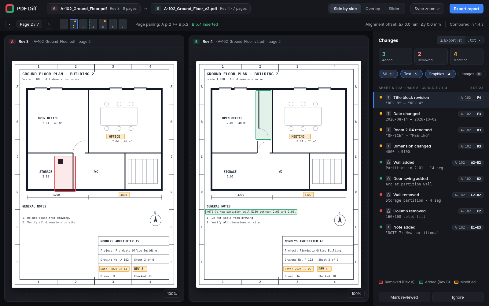

# PDF Diff

A web app that compares two revisions of the same PDF and highlights what changed, in both **text** and **vector graphics** (technical drawings, plans, schematics). Changes are shown side by side, as an overlay, or with a slider. They are listed with sheet number and drawing grid reference (e.g. `Sheet 1/26  D1–D3  Added  ...`) and can be exported as a plain-text report.

**Status:** planning + prototype. No web app code yet.

- [`PLAN.md`](PLAN.md): technical plan (architecture, text/vector diffing, grid detection, report format, milestones, prototype findings)
- [`docs/mockups/`](docs/mockups/): UI mockups (`mockup.png`, `export-preview.png`), built from `gen.py`, which writes the HTML; screenshot it with headless Chrome
- [`prototype/`](prototype/): Python proof of concept for the diff engine



## Running the prototype

Requires Python 3.11+ and `curl`.

```bash
cd prototype
python3 -m venv .venv && .venv/bin/pip install -r requirements.txt
./fetch_samples.sh          # downloads the two OpenHornet test PDFs into prototype/samples/
.venv/bin/python pdfdiff.py samples/OHC0003_rev-_v28.pdf samples/OHC0003_revA_v29.pdf \
    --label-a - --label-b A --out out
```

The prototype writes `out/report.txt` (plain-text change list) and side-by-side PNG renders of the three sheets with the most changes (red = removed, green = added, amber = modified). Example output is in [`prototype/examples/`](prototype/examples/).

### Synthetic tests

`prototype/tests/` generates PDF pairs with known ground truth: moved, resized and rotated shapes, moves close to the tolerance, dimension edits, moved text, whole-sheet shifts, style-only changes, negative controls, and cases derived from OpenHornet sheets. It scores the prototype against them:

```bash
.venv/bin/python tests/make_synthetic.py tests/out     # OpenHornet-derived cases need ./fetch_samples.sh first
.venv/bin/python tests/run_tests.py tests/out --render tests/renders
```

Results are in [`prototype/tests/RESULTS.md`](prototype/tests/RESULTS.md).

It covers: page pairing by title-block sheet number, border-grid detection (either label direction), sheet/drawing number extraction, positional word diff, sampled-geometry vector diff with tolerance, raster fallback, region grouping with grid refs, and folding of changes repeated on many sheets, page-offset alignment, clip-aware vector extraction, and pairing of removed/added shapes into moved / resized / rotated / style-only changes.

> The prototype uses **PyMuPDF (AGPL-3.0)**, which is fine for experimentation. The planned product uses permissively licensed libraries (PDF.js, pdf-lib, pdfium); see PLAN.md.

To rebuild the mockups:

```bash
cd docs/mockups && python3 gen.py
google-chrome --headless=new --hide-scrollbars --window-size=1600,1000 --screenshot=mockup.png "file://$PWD/mockup.html"
google-chrome --headless=new --hide-scrollbars --window-size=1600,1000 --screenshot=export-preview.png "file://$PWD/export-preview.html"
```

## Attribution

The test drawings (OHC0003 "ASSY, KNOBS", rev - and rev A) are from the **OpenHornet** project, <https://github.com/jrsteensen/OpenHornet>, © OpenHornet contributors, licensed **CC BY-NC-SA 4.0**. They are not included in this repository. `prototype/fetch_samples.sh` downloads them from the original repository. The sheet renders in `prototype/examples/` show these drawings with diff highlights and are shared under the same license, non-commercially, with attribution.
